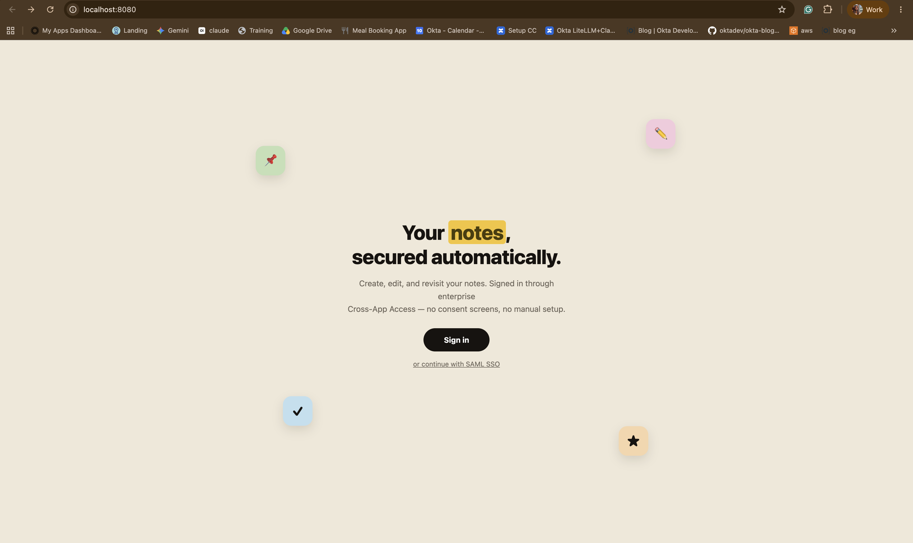

# AI Notes Assistant — XAA Demo (Go)

A Go web app (chi + `coreos/go-oidc`/`golang.org/x/oauth2` + `crewjam/saml`) demonstrating **Cross-App Access (XAA)** using the [official MCP Go SDK](https://github.com/modelcontextprotocol/go-sdk). It acts as a requester app that fetches a user's notes from a protected MCP Server, with no OAuth consent screens. 

---

## Understanding the Cross-App Access flow

XAA enables one app to securely access another app's resources on behalf of the same logged-in user, without additional consent prompts. The app streams each step live so you can watch the token exchange, Bearer token issuance, and MCP resource fetch happen in real time:

```
Step 1  User logs in via Enterprise SSO (OIDC + PKCE)
        ↓  id_token
Step 2  Token Exchange (RFC 8693) — id_token → ID-JAG assertion
        POST https://idp.xaa.dev/token
        ↓  ID-JAG
Step 3  JWT Bearer Grant (RFC 7523) — ID-JAG → Access Token
        POST https://auth.resource.xaa.dev/token
        ↓  Bearer token (aud: mcp.xaa.dev/mcp)
Step 4  MCP Server call via Streamable HTTP transport
        StreamableClientTransport → https://mcp.xaa.dev/mcp
        ReadResource("todo0://todos")
        ↓  Real todo data, reshaped into notes → AI analysis rendered in the UI
```

**Note on SAML:** RFC 8693's token exchange requires an OIDC `id_token` as `subject_token`. SAML assertions don't produce one, so `/login/saml` is a genuine alternate SSO login into the app UI, but a SAML-authenticated session cannot run the "Analyze My Notes" flow above — that's a protocol constraint, not a limitation of this demo. The app tells you this explicitly if you try.

---

## Setup

Requires **Go 1.25+**.

```bash
go mod tidy
```

Copy `config.json` and fill in real values (or edit it in place for local dev):

```json
{
  "xaa": {
    "clientId":        "<your-client-id>",
    "clientSecret":    "<your-client-secret>",
    "idpBaseUrl":      "https://idp.xaa.dev",

    "mcpClientId":     "<your-mcp-client-id>",
    "mcpClientSecret": "<your-mcp-client-secret>",

    "authServerUrl":   "https://auth.resource.xaa.dev",
    "mcpServerUrl":    "https://mcp.xaa.dev/mcp",
    "resourceUri":     "todo0://todos",
    "scope":           "todos.read mcp.access",

    "redirectUri":     "<app-url>/callback",
    "sessionSecret":   "<any-long-random-string>"
  },
  "saml": {
    "enabled": false
  },
  "port": 8080
}
```

Register your app on [xaa.dev](https://xaa.dev/?have=requesting&want=register&via=oidc):
- Redirect URI: `<app-url>/callback`
- Post-Logout Redirect URI: `<app-url>/logged-out`
- Add Resource → **ToDo MCP Server** → Add Connection

Then run:

```bash
go run .
```

By default the app listens on `http://localhost:8080`.

In a GitHub Codespace, get the forwarded URL and ready-to-use redirect URIs with:

```bash
bash scripts/get-redirect-uri.sh
```

---

## Enabling SAML SSO (optional)

1. Generate a self-signed key/cert pair for the SP:
   ```bash
   openssl req -x509 -newkey rsa:2048 -keyout saml-sp.key -out saml-sp.cert -days 365 -nodes -subj "/CN=oktane-go-mcp-xaa"
   ```
2. Register this app as a Service Provider with your SAML IdP (Okta, etc.) and get its metadata URL.
3. Set in `config.json`:
   ```json
   "saml": {
     "enabled": true,
     "idpMetadataUrl": "https://your-idp/app/.../sso/saml/metadata",
     "spCertFile": "saml-sp.cert",
     "spKeyFile": "saml-sp.key",
     "spRootUrl": "<app-url>"
   }
   ```
4. Restart the app — `/login/saml` becomes available and appears as a secondary link on the login screen.

If SAML setup fails at startup (bad metadata URL, missing cert files), the app logs a warning and keeps running with OIDC-only login — it never crashes on missing SAML config.

---

## Verifying the flow

The access token displayed in the sidebar after the flow runs is a real JWT issued by `https://auth.resource.xaa.dev`. The decoded claims (`iss`, `aud`, `sub`) are shown in the **Token Claims** chip — `iss = https://auth.resource.xaa.dev` confirms the token came from xaa.dev's authorization server, not mock data.

To see server-side logs: go to [xaa.dev/inspect?tab=mcp-server](https://xaa.dev/inspect?tab=mcp-server), paste the `sub` value from the Token Claims chip into the filter, then re-run the analysis.

---

## Tests

```bash
go test ./...
```

Covers the pure-function ports that don't need network/IdP access: `BuildInsights` (`internal/api`) and the todo→note parsing fallback chain (`internal/mcpnotes`).

## License
Apache 2.0 - see [LICENSE](LICENSE)
# oktane-go-mcp-xaa
